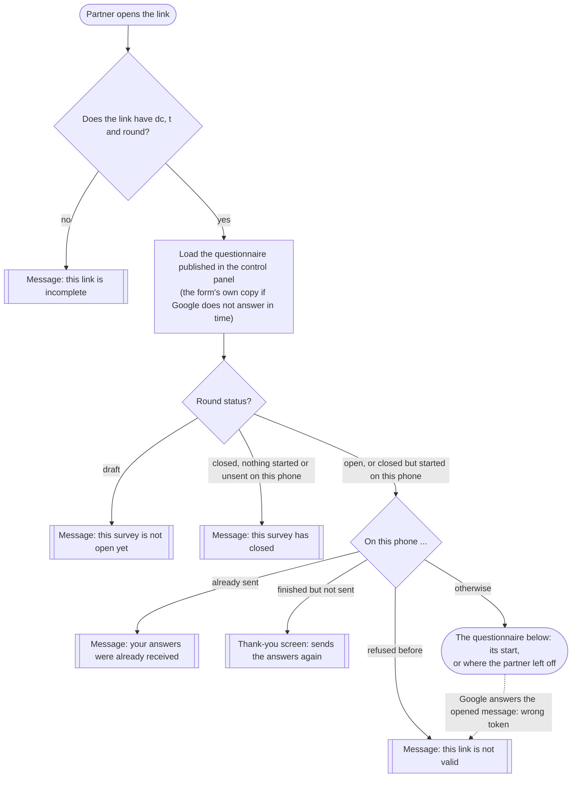
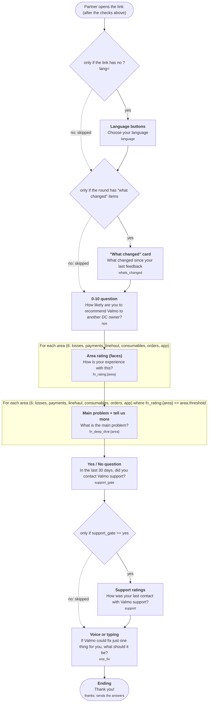

<!-- GENERATED by  node scripts/flow.js map --write  (or python3 scripts/flow.py map --write) from web/config/survey.json. Do not edit by hand: python3 scripts/check_config.py warns when it is out of date. -->
# The questionnaire as a map

**What this is.** A picture of every route a partner can take through the questionnaire, made by the same engine the phones run (`web/js/flow.js`), so it cannot disagree with the form.

- **Source:** `web/config/survey.json`, config_version `2026-10-19.1`, graph format `pp-flow/1`.
- **Regenerate it** after every change to the flow (Terminal, in the project folder): `python3 scripts/flow.py map --write`.
- **Check it:** `python3 scripts/flow.py check`. **Try answers:** `python3 scripts/flow.py simulate --set nps=4 --set support_gate=no`.
- How the flow format works: [flow-engine.md](flow-engine.md); in plain English: [config-guide.md](config-guide.md).

## 1. Before the questionnaire (fixed, in the form's code)

These checks are security rules, so they stay in `web/js/app.js` and no settings change can skip them.

## 2. The questionnaire

Boxes are screens, diamonds are "only if" rules (a "no" skips the screen), labelled arrows are jumps, framed boxes are loops, round boxes are endings (they send the answers).

## 3. Every screen

| Code | Kind | Question (English) | Shown | Then | Answers stored as |
|---|---|---|---|---|---|
| `language` | Language buttons | Choose your language | only if the link has no ?lang= | whats_changed | — |
| `whats_changed` | "What changed" card | What changed since your last feedback | only if the round has "what changed" items | nps | — |
| `nps` | 0-10 question | How likely are you to recommend Valmo to another DC owner? | always | fn_ratings | `nps` |
| `fn_ratings` | Area rating (faces) | How is your experience with this? | for each area (6) | fn_deep_dives | `fn_rating:{area}` |
| `fn_deep_dives` | Main problem + tell us more | What is the main problem? | for each area (6) where fn_rating:{area} &lt;= area.threshold | support_gate | `fn_deep_dive:{area}` |
| `support_gate` | Yes / No question | In the last 30 days, did you contact Valmo support? | always | support | `support_gate` |
| `support` | Support ratings | How was your last contact with Valmo support? | only if support_gate == yes | one_fix | `support:{item}` (4 items), `support_comment` |
| `one_fix` | Voice or typing | If Valmo could fix just one thing for you, what should it be? | always | thanks | `one_fix` |
| `thanks` | Thank you (sends the answers) | Thank you! | always | the end: sends the answers | — |

## 4. Example routes

Made by `simulate` with the answers shown (answers no rule tests are left out). 16 distinct routes in total; list them with `python3 scripts/flow.py paths`.

**1. The route most answer combinations take** (18 screens): fn_rating:app=1, fn_rating:consumables=1, fn_rating:linehaul=1, fn_rating:losses=1, fn_rating:orders=1, fn_rating:payments=1, support_gate=yes.

1. `language`: Choose your language
2. `nps`: How likely are you to recommend Valmo to another DC owner?
3. `fn_rating:losses`: Losses & Debits: How is your experience with this?
4. `fn_rating:payments`: Payments / Payouts: How is your experience with this?
5. `fn_rating:linehaul`: Line Haul: How is your experience with this?
6. `fn_rating:consumables`: Consumables: How is your experience with this?
7. `fn_rating:orders`: Orders & Planning: How is your experience with this?
8. `fn_rating:app`: App / Tech: How is your experience with this?
9. `fn_deep_dive:losses`: Losses & Debits: What is the main problem?
10. `fn_deep_dive:payments`: Payments / Payouts: What is the main problem?
11. `fn_deep_dive:linehaul`: Line Haul: What is the main problem?
12. `fn_deep_dive:consumables`: Consumables: What is the main problem?
13. `fn_deep_dive:orders`: Orders & Planning: What is the main problem?
14. `fn_deep_dive:app`: App / Tech: What is the main problem?
15. `support_gate`: In the last 30 days, did you contact Valmo support?
16. `support`: How was your last contact with Valmo support?
17. `one_fix`: If Valmo could fix just one thing for you, what should it be?
18. `thanks`: Thank you!

**2. The longest route** (19 screens): fn_rating:app=1, fn_rating:consumables=1, fn_rating:linehaul=1, fn_rating:losses=1, fn_rating:orders=1, fn_rating:payments=1, support_gate=yes; 1 "what changed" item.

1. `language`: Choose your language
2. `whats_changed`: What changed since your last feedback
3. `nps`: How likely are you to recommend Valmo to another DC owner?
4. `fn_rating:losses`: Losses & Debits: How is your experience with this?
5. `fn_rating:payments`: Payments / Payouts: How is your experience with this?
6. `fn_rating:linehaul`: Line Haul: How is your experience with this?
7. `fn_rating:consumables`: Consumables: How is your experience with this?
8. `fn_rating:orders`: Orders & Planning: How is your experience with this?
9. `fn_rating:app`: App / Tech: How is your experience with this?
10. `fn_deep_dive:losses`: Losses & Debits: What is the main problem?
11. `fn_deep_dive:payments`: Payments / Payouts: What is the main problem?
12. `fn_deep_dive:linehaul`: Line Haul: What is the main problem?
13. `fn_deep_dive:consumables`: Consumables: What is the main problem?
14. `fn_deep_dive:orders`: Orders & Planning: What is the main problem?
15. `fn_deep_dive:app`: App / Tech: What is the main problem?
16. `support_gate`: In the last 30 days, did you contact Valmo support?
17. `support`: How was your last contact with Valmo support?
18. `one_fix`: If Valmo could fix just one thing for you, what should it be?
19. `thanks`: Thank you!

**3. The shortest route** (10 screens): fn_rating:app=4, fn_rating:consumables=4, fn_rating:linehaul=4, fn_rating:losses=4, fn_rating:orders=4, fn_rating:payments=4, support_gate=no; a link with ?lang=.

1. `nps`: How likely are you to recommend Valmo to another DC owner?
2. `fn_rating:losses`: Losses & Debits: How is your experience with this?
3. `fn_rating:payments`: Payments / Payouts: How is your experience with this?
4. `fn_rating:linehaul`: Line Haul: How is your experience with this?
5. `fn_rating:consumables`: Consumables: How is your experience with this?
6. `fn_rating:orders`: Orders & Planning: How is your experience with this?
7. `fn_rating:app`: App / Tech: How is your experience with this?
8. `support_gate`: In the last 30 days, did you contact Valmo support?
9. `one_fix`: If Valmo could fix just one thing for you, what should it be?
10. `thanks`: Thank you!
